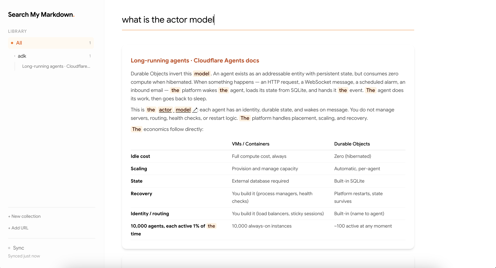

# Personal Markdown Search engine (PMS)

**PMS** is a lightweight, local-first hybrid search engine and web clipper for
personal Markdown knowledge bases, built in Python on top of **SQLite
(`FTS5` + `sqlite-vec`)** and **ONNX embeddings (`fastembed`)**.

It's a fast, minimal, CPU-friendly alternative to
[`qmd`](https://github.com/tobi/qmd): no GPU, no multi-gigabyte GGUF models, no
LLM APIs — just lightweight ONNX embeddings, structure-aware Markdown chunking,
and a small hackable codebase. Everything runs offline on your laptop.




## Features

- **Hybrid retrieval** — BM25 (FTS5) + vector KNN (`sqlite-vec`), fused with
  Reciprocal Rank Fusion.
- **Structure-aware chunking** — never splits a code fence, prefers heading
  boundaries, prepends the `H1 > H2 > H3` breadcrumb to each embedded chunk.
- **Built-in web clipper** — fetch any URL with `trafilatura` and save it as
  clean Markdown with YAML frontmatter.
- **Single-file storage** — metadata, full-text index, and vectors all live in
  one `.db` file.
- **Local web UI** — browse collections, clip URLs, and search from the browser.

> 📝 For the design decisions and lessons learned (chunking trade-offs, RRF
> tuning, the time a 17-document index became a 374MB file), see the
> accompanying blog post: **[https://benjaminetienne.com/blog/a-personal-markdown-search-engine/]**.

## Architecture

```
Web URL / Local .md files
        │
        ▼
┌────────────────────────────────────────────────────────┐
│ 1. Ingestion (trafilatura / local disk)                │
│    Saves Markdown with YAML frontmatter + SHA-256 hash │
└────────────────────────────────────────────────────────┘
        │
        ▼
┌────────────────────────────────────────────────────────┐
│ 2. Structure-Aware Chunking (pms.chunk)           │
│    • Respects code fences (never splits code blocks)   │
│    • Splits on H1–H3 boundaries & paragraph breaks     │
│    • Prepends [H1 > H2 > H3] breadcrumb to embed_text  │
└────────────────────────────────────────────────────────┘
        │
        ├─────────────────────────────┐
        ▼                             ▼
┌──────────────────────┐    ┌────────────────────────────┐
│ 3a. SQLite FTS5      │    │ 3b. fastembed + sqlite-vec │
│ Porter stemmer BM25  │    │ BAAI/bge-small-en-v1.5     │
│ full-text index      │    │ 384-d float32 cosine KNN   │
└──────────────────────┘    └────────────────────────────┘
        │                             │
        └──────────────┬──────────────┘
                       ▼
┌────────────────────────────────────────────────────────┐
│ 4. Reciprocal Rank Fusion (normalized)                 │
│    Combines lexical (BM25) + semantic rankings         │
└────────────────────────────────────────────────────────┘
```

## Installation

PMS uses [`uv`](https://docs.astral.sh/uv/) and requires Python 3.13+:

```bash
git clone https://github.com/<your-username>/PMS.git
cd PMS
uv sync
```

The embedding model (`BAAI/bge-small-en-v1.5`, ~130MB ONNX) downloads
automatically on first run.

## Quickstart (Python)

```python
from pms.kb import KnowledgeBase

# 1. Initialize the knowledge base (SQLite + fastembed ONNX model)
kb = KnowledgeBase()

# 2. Create a collection (a directory of Markdown files)
agents = kb.collections.create(
    path="./knowledge/agents",
    name="agents",
    description="Articles and notes on AI agent architectures",
)

# 3. Clip a web article straight into the collection as Markdown
agents.add_from_url(
    "https://developers.googleblog.com/build-long-running-ai-agents-with-adk/"
)

# 4. Sync disk files into SQLite (chunk, embed, and index new documents)
kb.sync()

# 5. Hybrid search (BM25 + vector + RRF)
for hit in kb.search("what is prompt context pollution", k=5):
    print(f"[{hit.score:.3f}] {hit.heading_path}")
    print(hit.text)
    print("---")
```

Each `Hit` carries the fused `score` plus the underlying `bm25_rank` and
`vec_rank`, so you can inspect exactly why a chunk ranked where it did.

## Run the web UI

```bash
uv run uvicorn pms.app:app --reload
```

Then open <http://127.0.0.1:8000> to browse collections, clip URLs, and search.

## Keeping the index in sync

PMS hashes every `.md` file (SHA-256) and compares it against the database,
so you can edit notes in any editor and re-sync:

```python
# Preview pending changes without touching the database
to_add, to_delete, to_update = kb.check_sync_status()
# -> Sync status: +1 new, ~0 modified, -0 deleted

kb.sync()  # apply them
```

## Using the chunker standalone

The chunker and the URL extractor are decoupled from the database:

```python
from pms.extract import extract_from_url
from pms.chunk import chunk_markdown

doc = extract_from_url("https://example.com/some-article")
chunks = chunk_markdown(doc.content, title=doc.title or "", target_chars=1000)
for c in chunks[:3]:
    print(c.heading_path, "|", c.embed_text[:120])
```

## Project structure

```
src/pms/
├── kb.py          # KnowledgeBase: orchestrates sync, chunk, embed, search
├── retrieval.py   # HybridRetrieval: BM25, vector KNN, RRF fusion
├── chunk.py       # Structure-aware Markdown chunker
├── extract.py     # URL → clean Markdown (trafilatura)
├── index.py       # Collections registry
├── storage.py     # Raw document storage helpers
├── app.py         # FastAPI app (JSON API + serves the UI)
└── ui.html        # Single-page web UI
```

## License

[MIT](LICENSE)
